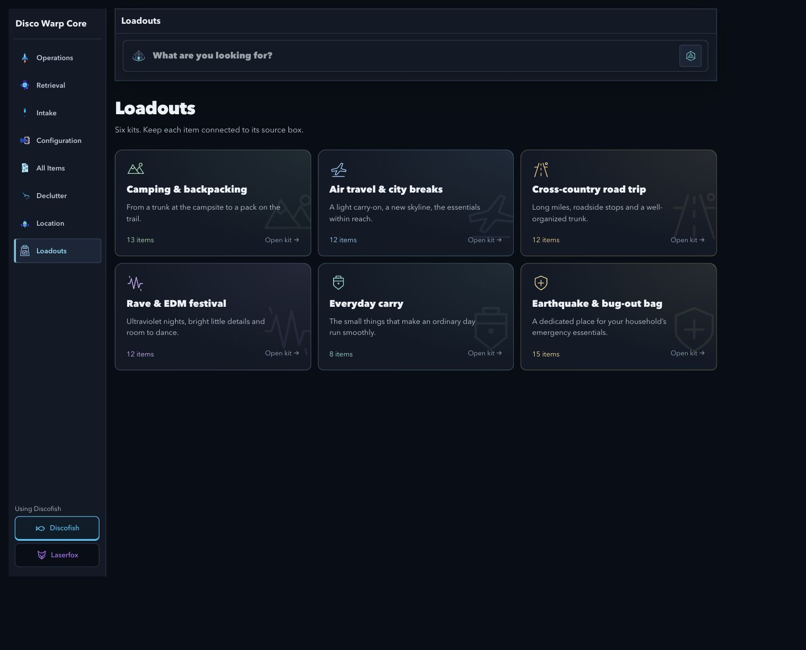
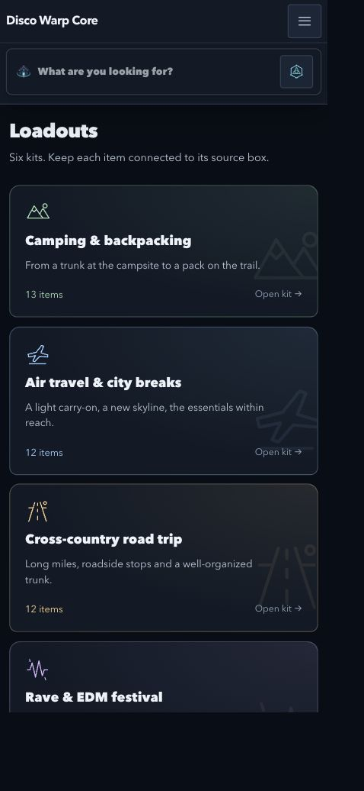

# Loadouts

Loadouts is a fixed set of six kits: camping/backpacking, air travel/city breaks, cross-country road trips, rave/EDM festivals, everyday carry and earthquake/bug-out bags. Open `/loadouts` to choose a kit. Each kit behaves visually like one simple box, with an editable contents list and each linked item's source box preserved.

The occasion colors and scene glyphs remain defined in [DESIGN_SYSTEM.md](../DESIGN_SYSTEM.md). The gallery shows the six kits once, in the user's order. There are no creation, template, archive, rename or palette-management controls.

## Contents and source boxes

- One list shows item names, source box numbers/names, recorded locations and small Gathered/Put away checks together.
- Edit items reveals inventory linking, relinking, unlinking, removal and adding items. Unlinked entries are explicitly labelled. Existing inventory item names link to their item pages; source box numbers link to their original boxes.
- Kits store Item references. They do not move items into a new physical box, alter box membership or change inventory locations. Compartment addresses, leading zeroes and box palette provenance remain intact.
- A gathered item can be marked put away. Ungathering clears its put-away check. Reset checks clears the two checks for the kit, with a persistent header confirmation and Undo.
- Unlinking and removing contents also retain header confirmations and Undo. Revision checks prevent stale edits from overwriting newer changes.
- The six saved records and their contents remain intact. The gallery selector filters custom and duplicate occasions without deleting stored records.
- `?loadout=<id>` identifies the selected kit. Legacy mode/archive query values do not introduce separate screens. The inventory picker owns its opening kit, preserving safe save targets across browser Back.
- The existing MongoDB model and API contracts are retained. This UI fetches the existing kits and updates contents only.

## Source organization

The route lives in `frontend/src/components/Loadouts/`. Gallery, workspace, entry row, inventory picker, state hook, pure checklist helpers, occasion definitions and styled-components stay separate. The former loadout creation/details editor was removed.

## Verification on October 13, 2026

- All 14 relevant tests passed, covering the fixed six-occasion selection/order, duplicate/custom filtering, checkbox invariants, payload validation, stable references, current source compartments/inherited locations and unavailable records.
- Live browser checks exercised linking an existing backpack from source box 120, both checks together, reload persistence, ungathering, unlinking, adding/removing a temporary item, Undo and preserving an unsaved addition when editing is collapsed.
- Contents were checked at measured CSS widths of 320, 430 and 678px plus the desktop layout. No horizontal overflow occurred, including a long item name. Check labels retain nominal 44px targets. Existing Prism palettes and high-contrast text colors were retained.
- The gallery was verified to contain exactly six kit links and no creation controls. Saved contents were restored after temporary QA changes.
- Production build, frontend lint and whitespace checks passed. Lint retains two pre-existing hook warnings in ItemEditForm and SystemLogsPage.
- Read-only item/box/location fingerprints verify that physical inventory remains unchanged. Tarot service ownership is retained; this simplification required no backend restart.

