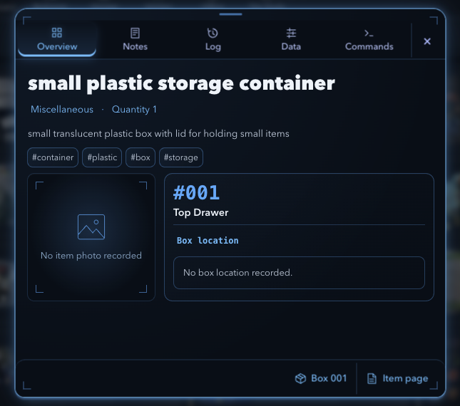

# Prism Console design philosophy and aesthetics

**Prism Console**, or **Prism**, is our name for the design language in your favorite Retrieval component. In plain design terms, it is a minimal sci-fi console: an opaque navy surface, a restrained neon perimeter, precise instrument details, and readable human typography. The name is a working vocabulary for us, rather than an established historical movement.

Its governing idea is simple: **an instrument surface, quietly illuminated by the identity of the thing it holds.** The frame supplies atmosphere. The information supplies the purpose. Good Prism design makes both feel intentional.

Open the [interactive reading edition](prism-console-design-guide.html) to explore the same lessons visually. The project's [DESIGN_SYSTEM.md](../DESIGN_SYSTEM.md) remains the implementation source of truth.

## Reading the reference

Look at what gets your attention first. The large white item name establishes the subject. The blue number identifies its physical context. The selected Overview tab shows where you are. The description and location are easy to find, but quieter. The light around the window gives everything a common container.

| Part of the reference | Design term | What it contributes |
| --- | --- | --- |
| Thin outer edge with soft light beyond it | Edge illumination and bloom | Defines the workspace and gives it atmosphere |
| Tiny brackets inside the corners | Registration marks | Suggests precision, like a calibrated instrument |
| Overview wash and bright bottom line | Selected state | Shows the current section without a large filled button |
| Large, heavy white item name | Typographic hierarchy | Makes the human subject the main event |
| Blue facts and quieter description | Contrast hierarchy | Separates context from prose |
| Photo beside box and location | Functional grouping | Connects what the object is with where it belongs |
| Quiet footer with two destinations | Action rail | Gives secondary navigation a stable place |

These are interpretations of the supplied screenshot. The actual component uses the same ingredients through `RetrievalItemSheet.styles.js`, `RetrievalItemPanel.styles.js`, `RetrievalOverview.styles.js`, and `retrievalItemPanelTheme.js` in `frontend/src/components/Retrieval/`.

## The influences behind the style

Our existing LCARS // Cyberpunk // Minimal direction supplies a useful family resemblance. The console metaphor gives us segmented navigation, precise labels, compact controls and a sense of purposeful equipment. Neon gives the window an energized edge. Minimal composition gives the information room to breathe.

The small corner brackets also resemble the framing language of a heads-up display, often shortened to HUD. Here they establish atmosphere without adding simulated telemetry. The soft highlight above the frame and darker underside suggest a shallow physical bezel: the rim around a screen or instrument.

Prism combines those cues with friendly, heavy sans-serif typography. That combination matters. Thin machinery-like details surround a large human name, so the interface feels technical while the subject stays approachable. The restrained blue/lilac relationship in this particular box gives it a cool, almost nocturnal character. Other box palettes can express the same language.

Useful shorthand in a design conversation is: “Make this Prism.” More precise direction is: “Use a Prism workspace with an opaque navy body, a quiet identity edge, a strong human title, and compact secondary controls.”

## Hierarchy decides what gets noticed

Hierarchy means arranging emphasis so the viewer can tell what matters. Size, weight, contrast and grouping all contribute to the reading order. [Nielsen Norman Group explains these tools in its guide to visual hierarchy](https://www.nngroup.com/articles/visual-hierarchy-ux-definition/).

In this reference, the title has the greatest typographic weight. The box number has strong color and a distinct font. Facts are smaller. Tags and navigation are smaller again. This gives your eye several useful stops without making every element equally loud.

For a new surface, write its intended reading order before styling it. An editing sheet might read: field title → existing value → editable input → Save → supporting context. An inventory row might read: human name → physical box → recorded location → available action. Styling should reinforce that order.

Try a simple critique: squint at the screenshot until you cannot read the words. The title, active tab, main content pair and window edge should still form a clear structure. If the border is all you notice, its light is probably too strong for that content.

## Spacing explains relationships

Proximity means that nearby elements tend to look related; enclosure means a shared boundary can group them. These principles explain why a name and its facts feel like one unit, and why the box number, box name and location belong together inside the placement card. [NN/G discusses proximity and common regions](https://www.nngroup.com/articles/visual-hierarchy-ux-definition/#3-grouping-proximity-and-common-regions).

The practical lesson is to use a smaller gap within a group and a larger gap between groups. In the desktop source, the main photo/location pair has a 12px gap and the body uses 14–16px insets. Those values serve a relationship; copying them everywhere would miss the point.

Start from a small spacing family such as 4, 8, 12, 16 and 24px, then choose intentionally. A 4px gap may connect a label with its value. A 12px gap can separate adjacent functional blocks. A 24px break can introduce a new subject. This is a practical starting scale for new work, while existing project tokens and route rules take precedence.

The empty space above the footer is also part of the composition. A short record does not need extra content to occupy it. That breathing room separates inspection from navigation. At small heights or with long notes, let the body scroll while the controls stay accessible.

## Typography balances human and machine

The project UI stack is **Avenir Next**, then Segoe UI and the system sans-serif. The data stack is **SFMono-Regular**, then Consolas and Liberation Mono. A font stack is a list of alternatives the browser can use when the first font is unavailable, so the exact letter shapes can vary between machines.

The human title uses a heavy weight. Its tight letter spacing and generous size make it feel confident and tangible. The box number uses monospace, where characters occupy equal-width slots, making `#001` read like a precise address. Body prose returns to the comfortable UI font.

Use that division consistently. Human names, instructions and descriptions need the UI font. Numbers and brief data labels can use monospace. A whole paragraph in a tiny terminal font would flatten the hierarchy and make reading harder.

The desktop Retrieval title is 1.7rem at weight 800; its description is .85rem. These are the compact dossier's source values. A teaching document or a longer form should use a larger reading size when its content and viewing distance need it. Consistency comes from the relationships between levels as well as the sizes themselves.

## Color tells you what kind of information you are seeing

The blue in the screenshot belongs to physical box `001`. The existing mapping gives that box the Sky palette, with primary `#50AAFF`, secondary `#A7B6FF`, and derived neon `#66BDFF`. The same panel for another physical box can use amber, teal, coral or another established palette while retaining Prism's structure.

There are three separate color jobs in the app:

| Color role | Question it answers | Examples |
| --- | --- | --- |
| Entity identity | Which box or item is this? | Box number, sheet edge, selected entity tab |
| Workflow context | Which part of the app am I using? | Retrieval Items/Boxes accents, structural navigation |
| Interaction and feedback | What can I do, and what happened? | Cyan keyboard focus, primary actions, danger, errors |

Keep those jobs intact when adapting a component. An amber box can still have a cyan focus outline and a coral destructive action. The existing color model, rather than a new aesthetic preference, determines the physical box palette. Compartment addresses inherit their physical box's palette; Items Adrift retains its neutral treatment.

Color also needs a second cue. The selected tab has an underline and a selected state. An error needs words. A box retains its printed number. This helps people understand the interface when hue differences are difficult to perceive.

## Depth comes from a few controlled cues

The reference uses a thin sharp boundary plus several increasingly soft shadows. A tiny inner highlight suggests an upper rim; a darker lower inset and cast shadow suggest separation from the background. A faint accent wash on an opaque navy base ties the interior to its frame.

The source shell halo uses three falloffs: 10px at .32 opacity, 32px at .18, and 64px at .10, all based on the box's primary RGB color. The increasing radius and decreasing strength create diffusion. The glow stays static, so it does not compete with reading.

Treat light as an attention budget. A focused sheet can carry a halo because it is the active workspace. A page of fifty rows needs much quieter boundaries. If every field, tag and separator emits the same intensity, the viewer loses that distinction.

The corner brackets are registration marks, not resize handles. The small horizontal handle belongs to the existing sheet gesture. Visual details should support the actual interaction model: decorative marks cannot promise controls that do not exist.

## Tokens make the language repeatable

A design token is a named decision reused across components. Instead of choosing a fresh navy for each screen, use the established background token. Instead of hardcoding blue on every sheet, use an entity accent at the entity boundary.

| Existing token or source | Current value or rule | Purpose |
| --- | --- | --- |
| `APP_VISUAL_THEME.background` | `#080e17` | Deep base behind the reference's faint wash |
| `surface` / `surfaceRaised` | `#111a26` / `#192637` | Opaque layers for panels and controls |
| `text` / `textSecondary` / `textMuted` | `#edf3fa` / `#bdcadb` / `#93a7be` | Reading hierarchy |
| `cyan` / `coral` | `#80dfff` / `#ff9d9d` | Focus/action and danger vocabulary |
| Box `001` primary / neon | `#50AAFF` / `#66BDFF` | This reference's entity identity |
| Retrieval desktop shell | Up to 605 × 547px | Focused dossier with context visible around it |
| Shell / functional frames | 18px top, 14px bottom / 12px | Soft outer enclosure and useful inner grouping |
| Desktop tabs / footer | 48px / 52px high | Stable navigation and destinations |
| Primary controls | At least 44px targets | Comfortable interaction despite small glyphs |

These values come from the current source, rather than sampling compressed screenshot pixels. Shared `--prism-sheet-*` variables let an opted-in sheet choose its surface, border, divider and halo without restyling every sheet. Existing documented density exceptions still need deliberate review when a surface is adapted.

## Readability is part of the aesthetic

Dark UI depends on usable contrast. Normal text needs at least 4.5:1 contrast; qualifying large text needs 3:1. Visual information required to recognize controls and their states needs 3:1 against adjacent colors. [W3C explains text contrast](https://www.w3.org/WAI/WCAG22/Understanding/contrast-minimum.html) and [non-text contrast](https://www.w3.org/WAI/WCAG22/Understanding/non-text-contrast.html).

Measure the final composited colors. A bright token can become faint after opacity or blending. Decorative corner marks can be quieter than an essential field boundary, but a necessary value cannot disappear into the atmosphere. The supplied screenshot establishes a visual target; it does not establish that every rendered state already meets those ratios.

Small visible icons can sit inside generous transparent targets. Give Close, Save and important navigation 44px targets. Keep keyboard focus visible, preserve dialog focus restoration, respect reduced motion and keep longer content scrollable. A surface feels polished when it remains easy to use.

## Adapting other parts of the app

Carry the shared principles into the existing surface before changing its structure. Each surface has a different job, so the same language should have different emphasis.

| Surface | Prism expression | Behavior to retain |
| --- | --- | --- |
| Box management sheet | Quiet entity frame, clear title, compact action rows and focused editing | Back versus Close, existing actions, confirmations and autosave |
| Field editor | Opaque input area, readable field name, fine identity edge and clear Save | Draft validation, explicit Save/Cancel, dirty-dismiss protection and Undo |
| Operations inspector | Persistent box context, readable hierarchy and restrained selected surface | Dock remains nonmodal, layout stays stable and resizing preserves state |
| Inventory rows | Shared alignment, quiet dividers, useful thumbnails and precise identifiers | Search, counts, full values, existing selection and navigation |
| Location workspace | Quiet navy surfaces and deliberate group spacing | Tier colors, real ancestry, hierarchy editing and persistent feedback |
| Route navigation | Compact shared rail with an unmistakable selected segment | Route names, deep links, target sizes and keyboard state |

Start future adaptation with a bounded surface such as a field editor or the box management sheet. Establish its default, hover, focus, selected, disabled, saving, error and dirty states. Then review at 430 × 932, 678 × 759, a wide desktop, and a narrow 320px width before carrying the pattern farther.

In this project, preserve the persistent header Toast system, physical color provenance and backend contracts. Use JavaScript and styled-components, reuse existing controllers and presenters, and make small changes that are easy to inspect. The screenshot's five tabs express that component's information architecture; a different component gets the sections its task requires.

## A small exercise for your design eye

Use the reading edition's experiment to change one thing at a time. Switch off the glow and notice how much structure the title, spacing and placement group still provide. Flatten the type hierarchy and notice how the subject becomes harder to pick out. Increase the glow and notice when the perimeter begins to distract from the content.

Then choose another component and answer these questions:

1. What should I notice first, and what should I do next?
2. Which elements belong together, and can space express that relationship?
3. Which colors indicate identity, interaction or feedback?
4. Which boundary actually helps me understand a group?
5. Does the design still work with a long name, missing photo, error or keyboard focus?

Change one emphasis decision and compare. Learning design becomes more concrete when you can explain why a change helps the task. “This feels good” is a useful starting reaction. “The title leads, the frame gives context, and the actions stay quiet until needed” is a design judgment we can reproduce.

## Source map

The approved screenshot was supplied on October 13, 2026. Its durable copy is `docs/design/prism-console-reference.png`.

- [Project design system](../DESIGN_SYSTEM.md)
- [Shared palette and font tokens](../frontend/src/styles/tokens.js)
- [Physical box palette mapping](../frontend/src/util/inventoryColorTheme.js)
- [Item panel theme and halo](../frontend/src/components/Retrieval/retrievalItemPanelTheme.js)
- [Outer sheet geometry](../frontend/src/components/Retrieval/RetrievalItemSheet.styles.js)
- [Tabs and footer](../frontend/src/components/Retrieval/RetrievalItemPanel.styles.js)
- [Overview typography and grouping](../frontend/src/components/Retrieval/RetrievalOverview.styles.js)
- [Desktop density overrides](../frontend/src/components/Retrieval/RetrievalDesktopDensity.styles.js)
- [Static corner marks](../frontend/src/components/Retrieval/RetrievalFrame.styles.js)

Use the repository sources and `DESIGN_SYSTEM.md` for implementation details; use Prism as the shared vocabulary for discussing the effect we want.
